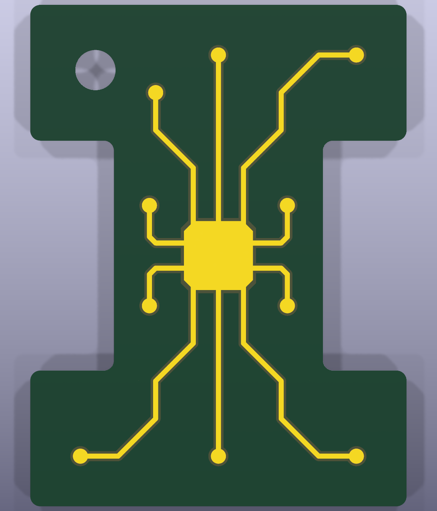

# UIUC PCB Keychain

A 30 × 40 mm PCB keychain shaped like the University of Illinois Block I.
The front features a gold birb outline, and the back has gold circuit artwork,
both on green solder mask. Made from 1.6 mm FR4 with a 3.2 mm keyring hole,
it needs no components or assembly—just add a split ring.

Inspired by the `uiuc-pcb-ruler` project. Editable KiCad files, fabrication
Gerbers, and scripts to rebuild the design are included.

## Front and back

KiCad 3D renders of the current design:

| Front | Back |
| --- | --- |
|  |  |
